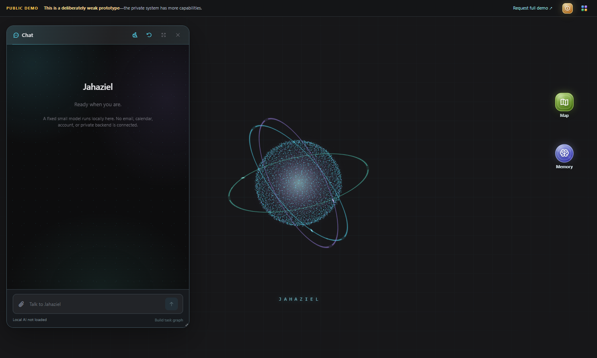

# Jahaziel — public prototype

**Important: this is a rough, stripped-down public preview—not the actual Jahaziel AI.** It omits connected accounts, API keys, the private backend, personal context, and the full specialist workflows. Do not interpret its small on-device model as the quality ceiling of the current private prototype. [Email Joel](mailto:joelayoade12@gmail.com?subject=Full%20Jahaziel%20demonstration) for a real demonstration.

For a demo or project questions, contact **Joel Ayoade** at [joelayoade12@gmail.com](mailto:joelayoade12@gmail.com?subject=Jahaziel%20demo%20request), [Instagram @Joe1_ayoade](https://www.instagram.com/Joe1_ayoade/), or find **Joel Ayoade** on LinkedIn. The exact LinkedIn profile URL has not been verified, so this page does not guess one.

Jahaziel is Joel Ayoade's experiment in consumer-customizable AI: an assistant that can plan work, remember responsibly, use tools, and let a non-coder describe how the assistant should change. This repository is a **standalone, safety-reduced demo** for interviews and portfolio review. It reuses selected visual components and theme styles from Joel's real front end, but contains no private backend, backend history, accounts, or personal data.



## Try it

Open the site to see the desktop interface. Click the particle avatar for its app ring, or use App Center in the top Dock. The local demo has:

- **The real front-end visual language.** Its particle avatar, theme tokens, desktop surfaces, app icon styling, and draggable/resizable floating-window component come from the current Jahaziel UI. The public shell imitates the familiar chat, app ring, top Dock, desktop shortcuts, and searchable App Center without connecting to Joel's personal workspace.
- **Real local AI chat, grounded in a capability inventory.** Click **Start local AI** in Chat, wait for **Local AI ready**, then send a message or use a suggested prompt. Qwen2.5 1.5B runs with WebGPU in the visitor's browser, with Qwen2.5 0.5B and SmolLM2 360M as lower-resource fallbacks. These are free on-device models. Progress is visible while the first model downloads. There is no OpenRouter dependency, account key, or inference backend. The preferred download is hundreds of megabytes and can take minutes; the browser caches model artifacts per site origin. The chat passes recent completed turns, user-saved local notes, and the same public/private capability inventory shown in About to the model, and persists the last 20 turns in that browser. The model composes answers to questions about unavailable tools instead of receiving keyword-matched canned replies. A safety check retries false claims of public account access; old false claims in saved transcripts are marked. In a built-site smoke test, the model recalled a user-stated color after a reload. This small public model is still substantially weaker than Jahaziel's private stack, and transcript recall is not guaranteed for every prompt. If WebGPU is unsupported, the app explains that and the other features remain usable.
- **AI-proposed task graph.** Describe a goal and request a task graph. The small local model proposes steps; the app puts them in a simplified sequential dependency graph and validates the result. The private system's parallel specialist DAG is much richer. A plan is not proof that tasks ran.
- **Explicit local memory.** Users can save and remove notes; the chat may use those notes. Nothing is silently extracted into memory. Notes and chat history remain in that browser's local storage, not on Joel's server and not synced between devices.
- **Interactive Jahaziel-style map.** The dark hologram grade, tilted camera, 3D buildings, toolbar, layer tray, and event strip mirror the private map. Pan, zoom, adjust pitch, enable Pin mode, or click **Locate** to explicitly grant browser location for that visit. The coordinates are not stored or sent to Joel's backend; public tile requests necessarily tell the map provider which area you are viewing. Live sky layers, calendar events, and satellite imagery are labeled unavailable in this build.
- **Complete app catalog, honest previews.** App Center lists all 23 main Jahaziel apps plus this demo's Customize and About windows. Each private-service dashboard has its own presentation layout and a visible explanation of what is blocked. These are previews of UI structure, not fabricated live data or working backend features.
- **Interface colors.** Change the same color roles used by the real front end; choices stay in this browser. The private JCode workspace goes much further, but this public app cannot rewrite source code.

The **About** app explains the larger system and gives Joel's contact details. The working desktop makes network requests for the public icon font, model artifacts, and map tiles. It has no email, calendar, browser automation, application submission, notification delivery, or account connections.

## Run locally

Requires Node 22+ and a recent browser with WebGPU for local AI.

```sh
npm ci
npm run dev
```

Open the local URL printed by Vite. To build or test:

```sh
npm run build
npm test
npm run test:browser
npm run test:catalog
npm run test:map-live
npm run test:model-live
npm run test:model-built
```

The ordinary browser tests check the interface without downloading model weights. `test:map-live` checks real public tiles and click-to-pin in the built site; it needs internet access. `test:model-live` checks development mode and `test:model-built` checks the production build for a real chat reply and task graph on a WebGPU-capable machine. Before an interview, open the final demo URL on the presentation device, click **Start local AI**, and wait for **Local AI ready**. Model downloads are cached per site origin, so preloading `localhost` does not preload the published URL. The map and model checks are separate because each depends on external public downloads.

## Privacy and publishing boundary

Do not merge either private Jahaziel repository's history into this repository. Do not add a real backend URL, account connection, credential, transcript, memory database, personal file, or browser profile. Only selected presentation-layer source is copied from the private UI and must be reviewed before each public update. The app needs access to public model-hosting, icon-font, and map-tile origins to function.

## What the private Jahaziel prototype actually contains

This is more than a chatbot UI. The private project combines these systems; the **About** window in the demo separates demonstrated workflows from those still being hardened:

- **Normal Chat with specialist orchestration:** ordinary requests can be planned as dependency-aware DAG work, routed to specialist departments, executed with tools, critiqued, and checked against independent read-back evidence. Live email and Apple Calendar read/write journeys have been exercised; broad first-try reliability remains in progress.
- **Jahaziel Code:** a governed coding workspace that can prepare diffs, run checks, and pause for explicit human approval. Approve, reject, rollback, and restart-persistence paths have served-browser proofs. Universal end-to-end coding autonomy is still being validated.
- **Project Engine, Library, and Task Hub:** longer work can have a durable plan, project workspace, decisions, evidence, handoffs, deliverables, and automation visibility. Plan confirmation is demonstrated; all cross-surface continuation paths are not yet proven.
- **Memory and adaptation:** extracts useful context from conversation and tool outcomes, distinguishes user-stated facts from uncertain inferences, supersedes corrected information, and can ask a focused question when needed. Focused live paths work; broader device and failure testing continues.
- **Communication and daily-life tools:** connected email, Apple Calendar, file delivery, linked alerts, and Watch Dog relevance triage. Gmail paths work; New Outlook ingestion still needs a supported transport. Sensitive outgoing actions remain review-gated.
- **Shared Web and research:** a browser workspace that user and AI can inspect and hand off, with tabs, navigation, page context, and review checkpoints. Complex sites and video understanding are experimental.
- **Engineering and spatial tools:** conceptual multi-part 3D assemblies, interactive components, GLB/STL export, and a live 3D/location map. These are not dimension-verified CAD or guaranteed-printable parts; full navigation is unfinished.
- **Model intelligence and Skin:** model selection uses capability, price, and observed health; Skin analyzes dependency and structural contracts to catch risky code changes. Live outage and complete scan-to-delivery qualification is still in progress.
- **Consumer interface:** a customizable desktop with a particle app ring, App Center, themes, app badges, notifications, and phone/tablet layouts. Voice, Lens, automations, and proactive behavior are active prototype areas rather than polished release claims.

This public app **does not run those private integrations**. Its small local model should not be judged as the quality of the actual multi-model backend. [Email Joel](mailto:joelayoade12@gmail.com?subject=Full%20Jahaziel%20demonstration) to see the current private system and its limitations live.

Technology: React, Vite, [WebLLM](https://github.com/mlc-ai/web-llm), [MapLibre GL JS](https://maplibre.org/maplibre-gl-js/docs/), and [OpenFreeMap](https://openfreemap.org/quick_start/).
